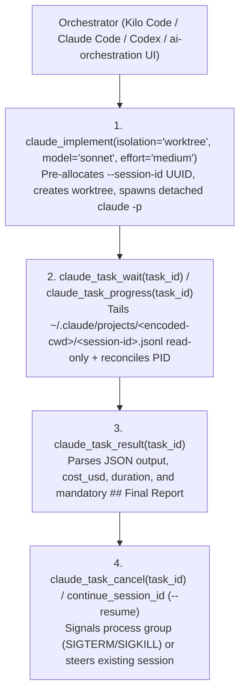

# claude-mcp

**Standalone MCP Server & Bound Orchestration Skills for Delegating Work to Headless Claude Code CLI Sessions.**

`claude-mcp` is the **Claude Code** execution binding of [`ai-orchestration`](../ai-orchestration/), mirroring [`kilo-mcp`](../kilo-mcp/). It exposes headless `claude` CLI sessions as first-class non-blocking MCP tools so any orchestrator (Kilo Code, Claude Code, a Python orchestration server, or CI) can dispatch implementation or cross-verification tasks to Claude in isolated Git worktrees.

---

## Architecture & Lifecycle

## Status & Implementation Tasks

Specification is complete and reviewed ([`SPEC.md`](SPEC.md), [`reviews/001-spec-review-kilo-gemini-3.7-flash.md`](reviews/001-spec-review-kilo-gemini-3.7-flash.md)). Implementation is broken down into 5 atomic tasks in [`tasks/00-INDEX.md`](tasks/00-INDEX.md) and [`tasks/01-claude-mcp-server/plan.md`](tasks/01-claude-mcp-server/plan.md), ready for execution.
