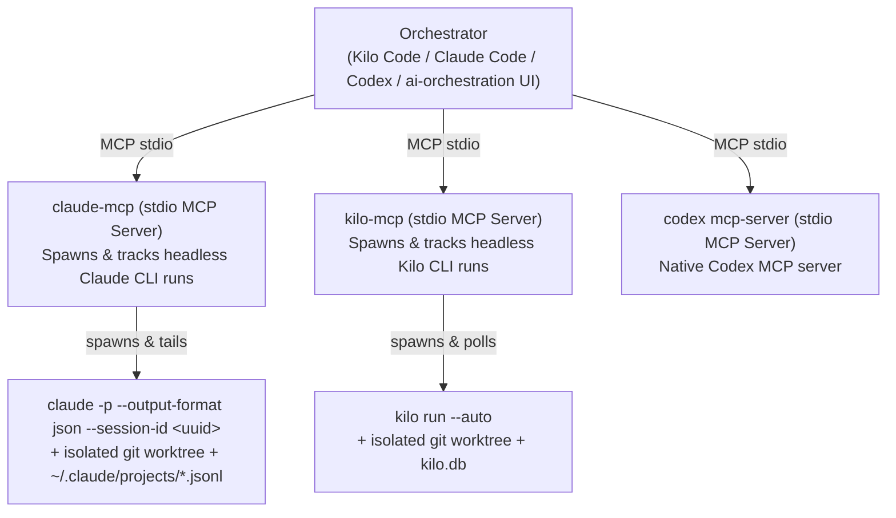

# Spec — `claude-mcp` (Headless Claude Code CLI MCP Binding)

> **Status:** Implementation-Ready Specification (v0.2.0 — incorporates all round-001 review findings B1–B4 & I1–I4 plus full symmetry with `ai-orchestration` and `kilo-mcp`).
> **Target Executor:** Claude Code (delegate tasks `01.1`–`01.5` in [`tasks/01-claude-mcp-server/plan.md`](tasks/01-claude-mcp-server/plan.md) as soon as credits unlock).

---

## 0. Purpose & Architectural Role

`claude-mcp` is a standalone Model Context Protocol (MCP) server that wraps the **Claude Code CLI (`claude`)** so any external orchestrator—a Kilo Code session, a Python orchestration server (`ai-orchestration`), a CI pipeline, or another Claude instance—can dispatch, monitor, await, cancel, and cross-verify tasks in headless Claude Code sessions.

In the `ai-orchestration` ecosystem:
- **`ai-orchestration` (`../ai-orchestration`)** owns the protocol-agnostic Architect/Executor skills, `SKILL.template.md` sources, `orchestration.toml`, and `tasks/` state engine.
- **`kilo-mcp` (`../kilo-mcp`)** is the concrete MCP binding for headless **Kilo CLI** sessions.
- **`claude-mcp` (this repo)** is the concrete MCP binding for headless **Claude Code CLI** sessions, plus the generated `claude-mcp-*` skill variants (`claude-mcp-orchestrator`, `claude-mcp-metrics-analyst`, `claude-mcp-conflict-resolver`, `claude-mcp-headless-executor`, and `claude-mcp-orchestrator-agent`).



---

## 1. Locked-In Architecture Decisions (Resolving Round-001 Review Findings B1–B4 & I1–I4)

### 1.1 Dispatch Architecture: Detached Subprocess (`claude -p --output-format stream-json --verbose`) with Pre-Allocated `--session-id` (Resolves B2 & B3)
- **Why not `claude --bg` (Option A)?**
  Round-001 empirical testing (`reviews/001-spec-review-kilo-gemini-3.7-flash.md`) proved that:
  1. `claude agents --json --all` omits OS PIDs, exit codes, and output for `kind: "background"` agents, and `claude agents` has no `stop`/`kill`/`cancel` subcommand (B3);
  2. Crucial governance flags (`--output-format`, `--max-budget-usd`, `--fallback-model`) only work with `-p`/`--print`, which cannot be combined with `--bg` (B2).
- **Locked Architecture (Option B — Detached `-p` Subprocess, mirroring `kilo-mcp`):**
  1. Pre-allocate `session_id = str(uuid.uuid4())` before spawning (I2).
  2. When `background=True`, spawn `claude -p "<prompt>" --output-format json --session-id <session_id> ...` in a detached process group (`subprocess.Popen(..., start_new_session=True, stdin=DEVNULL, stdout=log_file, stderr=STDOUT)`).
  3. Persist an on-disk task record at `$CLAUDE_MCP_DATA_DIR/tasks/<task_id>.json` containing `task_id`, `session_id`, `pid`, `pgid`, `working_directory`, `worktree_path`, `branch`, `log_path`, `transcript_path`, `model`, `effort`, `started_at`, and `status`.
  4. Reconcile orphaned tasks on server restart via `_is_pid_alive(pid)` + reading the JSON output in `log_path` and the JSONL transcript at `~/.claude/projects/<encoded-cwd>/<session_id>.jsonl`.

### 1.2 Authentication & `--bare` Safety Guard (Resolves B1)
- Passing `--bare` to `claude` disables OAuth and macOS Keychain credentials completely, requiring `ANTHROPIC_API_KEY` or `apiKeyHelper`.
- **Rule:** `claude_implement` defaults to `bare=False`. If the caller passes `bare=True`, the server checks whether `ANTHROPIC_API_KEY` is present in the environment (or `settings` contains `apiKeyHelper`); if not, it returns an immediate, actionable validation error instead of spawning a doomed process.

### 1.3 Read-Only Tail Transcript Polling vs. Session Steering (Resolves B4 & I3)
- **`claude_task_progress(task_id)` never calls `claude --resume`**, because resuming a live session causes lock conflicts and mutates conversation state.
- Instead, `claude_task_progress` reads the tail (last 64 KB / last N JSONL lines via `os.lseek` from `os.SEEK_END`) of `~/.claude/projects/<encoded-cwd>/<session_id>.jsonl` (plus process CPU/elapsed time via `ps`) in strictly read-only mode.
- **`continue_session_id` (`--resume <session_id>`)** is used **only** in `claude_implement` when steering a *completed, bounced, or cancelled* session.

### 1.4 Worktree Isolation & Lifecycle Cleanup (Resolves I4)
- When `isolation="worktree"` is requested, `claude-mcp` creates an isolated git worktree under `<repo>/.claude/worktrees/<branch_slug>` (or uses `git worktree add -b <branch> <path>`) so that `claude-mcp` knows the exact `worktree_path` and `branch` deterministically before spawning `claude`, and so `claude_workspace_status` can inspect all active worktrees.

---

## 2. Complete MCP Tool Surface (`server.py`)

Designed for 1:1 operational symmetry with `../kilo-mcp/server.py`:

### 2.1 Execution & Session Steering
1. **`claude_implement`**
   ```python
   @mcp.tool()
   async def claude_implement(
       task_instructions: str,
       working_directory: str,
       focus_files: list[str] | None = None,
       isolation: str = "none",              # "none" | "worktree"
       branch_name: str = "",
       model: str = "sonnet",                # "opus" | "sonnet" | "haiku" or full model ID
       effort: str = "medium",               # "low" | "medium" | "high" | "xhigh" | "max"
       permission_mode: str = "acceptEdits", # "acceptEdits" | "auto" | "bypassPermissions" | "dontAsk" | "plan"
       max_budget_usd: float | None = None,
       fallback_model: str = "",
       agent: str = "",                      # Optional --agent <name> (I1)
       allowed_tools: list[str] | None = None,    # Optional --allowed-tools (I1)
       disallowed_tools: list[str] | None = None, # Optional --disallowed-tools (I1)
       skills_to_load: list[str] | None = None,
       continue_session_id: str = "",        # Passes --resume <session_id>
       bare: bool = False,                   # Guarded per §1.2 (B1)
       background: bool = True,
       timeout_seconds: int = 900,
   ) -> str
   ```
   - Prepends the headless executor contract reminder + `focus_files` read mandate + mandatory `## Final Report` format (`Outcome`, `Files changed`, `Verification`, `Issues`).
   - Returns JSON with `task_id`, `session_id`, `pid`, `working_directory`, `worktree_path`, `branch`, `status`.

### 2.2 Monitoring, Blocking Wait, Result & Cancellation
2. **`claude_task_progress(task_id: str) -> str`**
   - Reconciles PID liveness; reads tail of `<session_id>.jsonl` transcript to extract latest tool calls, assistant text, token usage, cost USD, and OS CPU/elapsed time.
3. **`claude_task_wait(task_id: str, timeout_seconds: int | None = None) -> str`**
   - Async poll loop (`asyncio.sleep(2.0)`) with orphan/log-file reconciliation. Returns `claude_task_result(task_id)` as soon as the task reaches a terminal state (`completed`, `failed`, `cancelled`, `error`), or a non-throwing `"STILL_RUNNING"` status summary on timeout.
4. **`claude_task_result(task_id: str) -> str`**
   - Extracts the final structured JSON result (`result`, `cost_usd`, `duration_ms`, `num_turns`, `session_id`, parsed `Final Report`) and writes a telemetry row to `$CLAUDE_MCP_DATA_DIR/metrics.jsonl`.
5. **`claude_task_cancel(task_id: str) -> str`**
   - Sends `SIGTERM` (followed by `SIGKILL` after grace period) to the detached process group (`os.killpg(pgid, ...)`), marks the task record `cancelled`, and returns the `session_id` and `worktree_path` for follow-up or cleanup.
6. **`claude_task_status() -> str`**
   - Lists all tracked tasks (`WORKING`, `COMPLETED`, `FAILED`, `CANCELLED`) across the server.

### 2.3 Discovery, Workspace & Telemetry
7. **`claude_workspace_status(working_directory: str) -> str`** — git status, current branch, and active worktrees.
8. **`claude_list_models() -> str`** & **`claude_auth_status() -> str`** — reports available Claude model aliases/IDs, effort levels, and `claude auth status` output.
9. **`claude_log_issue(run_id: str, category: str, severity: str, description: str, files_affected: list[str] | None = None) -> str`** — appends defect telemetry to `issues.jsonl`.
10. **`claude_log_decision(branch: str, reason: str, task_ref: str = "", followup_needed: bool = False, run_id: str = "") -> str`** — records orchestration branch (`delegate` | `inline` | `escalate` | `discarded`) to `decisions.jsonl`.
11. **`claude_metrics(working_directory: str = "") -> str`** — aggregates cost, success/cancel/bounce rates, defect breakdown, and decision telemetry.

---

## 3. Bound Skills & Agent (`plugins/` + `bindings/`)

Just like `kilo-mcp`, `claude-mcp` uses `../ai-orchestration/scripts/generate_binding.py` with `claude-mcp/bindings/*.json` to generate its concrete skills without duplicating prose:
- `plugins/architect-side/skills/claude-mcp-orchestrator/` (from `orchestration-methodology/SKILL.template.md`)
- `plugins/architect-side/skills/claude-mcp-metrics-analyst/` (from `delegation-roi-analysis/SKILL.template.md`)
- `plugins/architect-side/skills/claude-mcp-conflict-resolver/` (from `conflict-resolver/SKILL.template.md`)
- `plugins/architect-side/agents/claude-mcp-orchestrator-agent.md`
- `plugins/executor-side/skills/claude-mcp-headless-executor/` (from `headless-executor-contract/SKILL.template.md`)

---

## 4. Implementation Plan (Ready to Delegate to Claude)

See [`tasks/00-INDEX.md`](tasks/00-INDEX.md) and [`tasks/01-claude-mcp-server/plan.md`](tasks/01-claude-mcp-server/plan.md) for the 5 one-commit tasks (`01.1`–`01.5`).
